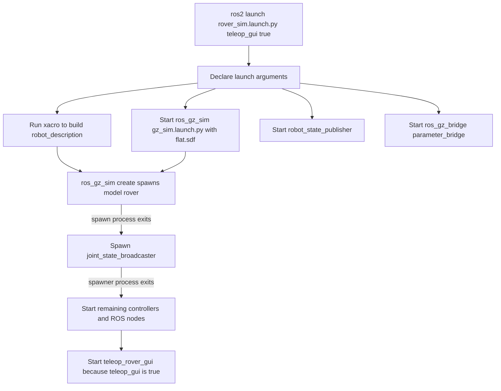
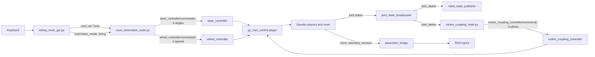

# Launch Workflow and Code Map

This guide follows the command:

```bash
ros2 launch rover_gazebo rover_sim.launch.py teleop_gui:=true
```

It describes the default arguments used by that command and separates code that runs
at startup from alternatives and test/build tools. The launch file is the authority
for process ordering; the Xacro and YAML files determine what those processes load.

## Effective Arguments

Only `teleop_gui` is overridden in the command. The other values below come from
`rover_sim.launch.py`:

| Argument | Effective value | Effect |
|---|---|---|
| `world` | `flat.sdf` | Starts the flat test world. |
| `sim` | `harmonic` | Generates Harmonic Gazebo plugin names. |
| `physics_engine` | empty | Leaves Gazebo's engine selection at its default, DART. |
| `suspension` | `torque` | Runs the four-rocker torque coupling path. |
| `gui` | `true` | Starts Gazebo with its graphical interface. |
| `teleop` | `false` | Does not start terminal teleop. |
| `teleop_gui` | `true` | Starts the Tkinter keyboard window. |
| `x`, `y`, `z`, `yaw` | `0`, `0`, `0.02`, `0` | Initial rover pose passed to the spawn process. |
| `mass_scale`, `mesh_collision` | `1.0`, `false` | Keep default model mass and simplified collision setting. |

`gui` and `teleop_gui` are different switches: the former is Gazebo's view; the latter
is the keyboard controller window.

## Startup Workflow



The launch does not start all actions in a strict serial chain. Gazebo, the state
publisher, bridge, and spawn process are launched together. Event handlers impose two
important gates: controller spawning waits for the spawn process to exit, and the other
controllers/nodes wait for the joint-state-broadcaster spawner process to exit.

The controller manager is **not** a separate process launched here. It is created by
the `gz_ros2_control` plugin embedded in the spawned model. `spawner` processes contact
that manager and exit after loading/activating their requested controller.

## Runtime Data Flow



Topic names in the diagram are relative names in the root namespace; they appear as
`/cmd_vel`, `/joint_states`, and so on in this launch.

## Files And Responsibilities

### Launch and model description

| Location | What it does in this launch |
|---|---|
| `launch/rover_sim.launch.py` | Entry point. Declares arguments, selects config files, runs Xacro, starts Gazebo/RSP/bridge/spawn, then starts controllers and nodes through process-exit handlers. Conditions select terminal teleop, GUI teleop, and suspension implementation. |
| `worlds/flat.sdf` | Default world loaded by Gazebo. `world:=ledge.sdf` and `world:=bars.sdf` select the obstacle test worlds instead. |
| `urdf/rover.urdf.xacro` | Xacro entry point. Includes the rover body, Gazebo-specific systems, sensors, and ros2_control description. |
| `urdf/rover_body.xacro` | Links, joints, masses, geometry, and suspension structure. It is generated from the CAD export; avoid hand-editing generated sections. |
| `urdf/rover_gazebo.xacro` | Gazebo contact settings plus the ground-truth odometry and `gz_ros2_control` plugins. Selects plugin names based on `sim`. |
| `urdf/rover_sensors.xacro` | Defines the IMU, GPU lidar, and RGB-D camera in the rover model. |
| `urdf/rover_ros2_control.xacro` | Exports joint command/state interfaces and chooses the Harmonic or Fortress ros2_control hardware plugin. |

### Configuration

| Location | What it configures |
|---|---|
| `config/controllers.yaml` | Default controller types, joint groups, and interfaces. Includes standard steering/wheel controllers, rocker effort controller, and the optional PID controller pair. |
| `config/controllers_mimic.yaml` | Alternative controller configuration for `suspension:=mimic`; not selected by this command. |
| `config/rover_control.yaml` | Parameters for kinematics, both teleop node names, the explicit PID node, and the rocker coupling/hold nodes. Only each launched node's matching parameter block applies. |
| `config/rover_kinematics.yaml` | CAD-derived wheel positions, radii/signs, and rocker constraint ratios used by the kinematics and suspension nodes. |
| `config/bridge.yaml` | Gazebo-to-ROS mapping for clock, odometry, IMU, lidar, and camera data. |

### Long-running ROS nodes

| Executable / node name | Started here? | Inputs and outputs / purpose |
|---|---|---|
| `robot_state_publisher` | Yes | Gets `robot_description` and `/joint_states`; publishes `/tf` and `/tf_static`. |
| `ros_gz_bridge parameter_bridge` | Yes | Relays `/clock`, `/odom`, `/imu/data`, lidar, and camera topics from Gazebo to ROS. |
| `rover_kinematics_node.py` / `rover_kinematics` | Yes | Subscribes to `/cmd_vel` and `/rover/steer_mode`; publishes steering/wheel commands and `/rover/steer_aim`. Converts requested body motion into four wheel angles and speeds for Ackermann, crab, and spot. Explicit modes instead aim all wheels together. |
| `rocker_coupling_node.py` / `rocker_coupling` | Yes, because `suspension:=torque` | Reads rocker state from `/joint_states`; publishes four effort commands to maintain the virtual suspension constraints. Runs its control timer at 500 Hz by default. |
| `control_node.py` / `explicit_pid_control` | Yes | Supports mode 5 (`explicit_pid`). It subscribes to mode and target topics from startup, but creates its high-rate joint-state/odometry subscriptions and PID timer only while that mode is active. |
| `teleop_rover_gui.py` / `teleop_rover_gui` | Yes, because `teleop_gui:=true` | Reads key press/release events and publishes `/cmd_vel` and `/rover/steer_mode`; subscribes to `/rover/steer_aim` for the explicit-mode display. Needs a graphical display and keyboard focus. |

`gz_ros2_control` also runs the **controller manager inside Gazebo**. The controller
names below are manager components, not separate ROS nodes launched by this file:

| Controller | Startup state | Role |
|---|---|---|
| `joint_state_broadcaster` | Active | Publishes `/joint_states` from simulated joint state. |
| `steer_controller` | Active | Applies the four position commands from kinematics. |
| `wheel_controller` | Active | Applies the four wheel velocity commands from kinematics. |
| `rocker_coupling_controller` | Active | Applies rocker effort commands from `rocker_coupling_node`. |
| `steer_pid_controller`, `wheel_pid_controller` | Loaded inactive | Used instead of the standard steering/wheel controllers in mode 5. `rover_kinematics` switches controller pairs through `/controller_manager/switch_controller`. |

## What The GUI Keypress Path Does

`teleop_rover_gui.py` is primarily a keyboard/UI frontend. It subclasses
`TeleopCore` from `rover_gazebo/teleop_common.py`, which owns the shared publishers,
mode state, and mapping from key state to `Twist`:

1. The GUI samples held keys at the configured 50 Hz update rate. W/S determine
   forward/reverse; A/D determine turn or steering, depending on mode.
2. `teleop_common.py` publishes a `Twist` on `/cmd_vel`. It also publishes
   `/rover/steer_mode` when the selected mode changes. On startup it announces
   Ackermann mode.
3. `rover_kinematics_node.py` receives those topics. It ramps speed and yaw requests,
   enforces limits, and stops stale motion commands after `command_timeout`.
4. For modes 1–3, kinematics computes per-wheel ground velocity, steering direction,
   and wheel speed, then publishes four values to each standard controller command
   topic. Mode 4 publishes explicit steering/speed commands through those same
   controllers. Mode 5 publishes targets for `control_node.py` instead.
5. The controller manager forwards active controller outputs through the model's
   ros2_control interfaces to the Gazebo joints.
6. Gazebo advances the rover. The broadcaster makes joint state available to
   `robot_state_publisher` and the rocker coupling loop.

The shared teleop code is in `rover_gazebo/teleop_common.py`; the terminal frontend
`rover_gazebo/teleop_rover.py` is an alternative and is **not** started by this
command. Both frontends use the same command logic, so running both is not needed for
one rover.

## Conditional And Non-Runtime Paths

| Location | Status for this command | Why it exists |
|---|---|---|
| `rover_gazebo/teleop_rover.py` | Not started | Terminal-based alternative to the GUI; selected with `teleop:=true`. |
| `rover_gazebo/rocker_hold_node.py` | Not started | Single-joint hold used with the alternate mimic suspension path. |
| `config/controllers_mimic.yaml` | Not loaded | Controller joint list for `suspension:=mimic`. |
| `rover_gazebo/measure_rover.py`, `rover_gazebo/stability_test.py` | Not started | Measurement and stability test utilities. |
| `tools/derive_ratios.py`, `tools/generate_description.py` | Not started | Build-time/model-generation utilities, not runtime launch nodes. |
| `rviz/rover.rviz` | Not opened by this launch | RViz configuration for a separately started RViz session. |

## Redundancy And Simplification Map

“Not used in this invocation” does not automatically mean “unnecessary in the
package.” The rows below distinguish optional paths from likely cleanup candidates.

| Area | Assessment | What to verify before removing or changing it |
|---|---|---|
| GUI teleop vs terminal teleop | Alternative frontends, not duplicate control logic. Both use `teleop_common.py`; only one is selected by this command. | Keep both if users need both display and SSH/no-display workflows. If not, choose one frontend and remove its launch/package/install/docs path together. |
| Standard controllers vs PID controllers | Intentional alternatives. Standard pair is active normally; the PID pair is loaded inactive so mode 5 can switch without relaunching. | Removing the PID pair also removes mode 5 and requires edits to kinematics, `control_node.py`, teleop modes, controller YAML, launch spawners, and docs. |
| `control_node.py` always launched | Small possible lifecycle simplification, not obviously dead code. Its PID timer and high-rate subscriptions are created only in mode 5, but the node itself, mode/target subscriptions, and report timer exist from startup to allow live switching. | Compare startup/idle overhead against the requirement to select mode 5 without restarting. A conditional launch action cannot respond to a later topic mode change by itself. |
| `rocker_coupling_node.py` vs `rocker_hold_node.py` | Mutually exclusive suspension implementations. Only the coupling node is active for this command. | Do not combine/remove one without dropping its corresponding `suspension` option and Xacro/controller configuration. |
| `/lidar/points` and `/lidar/scan` bridge entries | Two ROS representations from the same simulated lidar, not duplicate ROS message endpoints: one is point cloud, one is laser scan. | If no consumer needs one representation, remove that bridge mapping and validate downstream perception/navigation. |
| `/odom` bridge | Gazebo ground-truth output. The PID node can use yaw rate in mode 5; external packages may also consume it. Its configured yaw-damping gain is currently zero. | Search workspace consumers before removing. The bridge output is still useful for validation and estimator comparison. |
| `robot_state_publisher` and Gazebo robot model | Both use the same robot description but serve different outputs. Gazebo simulates physics; RSP publishes ROS transforms. | These are not duplicates. Removing RSP generally breaks TF consumers; removing Gazebo eliminates simulation. |
| Launch `spawner` processes | They exit after controller setup; they are not persistent duplicate controllers. | Treat them as startup helpers, not idle runtime nodes. |
| Generated model/config sections and tools | Some description and kinematics data are generated from CAD. | Check generator inputs and generated-file headers before hand-editing or deleting; edits may be overwritten. |

### Good First Places To Trace A Change

- Change keyboard behavior: `rover_gazebo/teleop_common.py`, then check both
  frontends and the `teleop_rover`/`teleop_rover_gui` blocks in
  `config/rover_control.yaml`.
- Change wheel-solving behavior or limits: `rover_gazebo/rover_kinematics_node.py`,
  `config/rover_control.yaml`, and CAD-derived `config/rover_kinematics.yaml`.
- Change which joints/controllers are active: `config/controllers.yaml`,
  `urdf/rover_ros2_control.xacro`, and the spawners/controller switch in
  `launch/rover_sim.launch.py`.
- Change suspension behavior: `rover_gazebo/rocker_coupling_node.py`,
  `config/rover_control.yaml`, `config/rover_kinematics.yaml`, and the suspension
  branch in the Xacro/controller configuration.
- Add, remove, or rename a simulated sensor topic: `urdf/rover_sensors.xacro` and
  `config/bridge.yaml`; check consumers of the ROS topic as well.

`CMakeLists.txt` installs the launch, model, config, and executable scripts into the
package share/lib directories. `package.xml` declares runtime dependencies. They affect
whether these files are available after a build, but they do not implement the runtime
control flow.